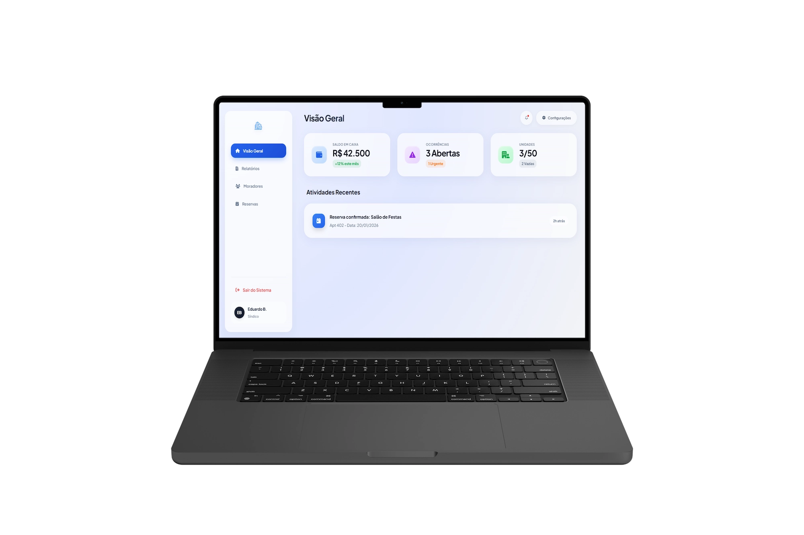

<div align="center">

# 🏢 Gestão Inteligente de Condomínios

**Plataforma SaaS Full Stack para transparência financeira, reservas de áreas comuns, ocorrências e administração condominial em tempo real.**

<a href="LICENSE"></a>

<a href="https://monitoramento-de-condominio.vercel.app/"></a>


<br/>
<br/>



<br/>

<p>
  <a href="https://monitoramento-de-condominio.vercel.app/"><strong>🌐 Acessar Aplicação em Produção</strong></a>
</p>

<p>
  <a href="#-visão-geral">Visão Geral</a> •
  <a href="#-módulos-e-funcionalidades">Funcionalidades</a> •
  <a href="#-stack-tecnológica">Stack</a> •
  <a href="#-arquitetura-e-engenharia">Arquitetura</a> •
  <a href="#-banco-de-dados-e-segurança">Banco de Dados</a> •
  <a href="#-estrutura-do-projeto">Estrutura</a>
</p>

</div>

---

## ✨ Visão Geral

O **Gestão Inteligente de Condomínios** é uma aplicação web Full Stack desenvolvida com **JavaScript ES6+ modular nativo** e **Supabase (PostgreSQL, Auth, Views, RPC e Realtime WebSockets)** para centralizar as operações críticas de um condomínio: prestação de contas transparente, reserva de áreas comuns com validação de conflitos, registro de ocorrências e gestão de moradores com controle de acesso baseado em papéis (**RBAC**).

O projeto foi arquitetado sem dependência de frameworks pesados no cliente para garantir carregamento instantâneo, aplicando padrões modernos de engenharia como cache em memória com TTL dinâmico (`SmartCache`), deduplicação de requisições concorrentes (`fetchWithDedup`), sanitização contra XSS e adaptação automática de efeitos visuais conforme a capacidade de hardware do dispositivo (`performance.js`).

---

## 🧩 Módulos e Funcionalidades

### 🔐 Autenticação & Segurança (`src/auth`)
- **Fluxo completo via Supabase Auth:** Login com persistência opcional de sessão (`keepSession` em `localStorage` vs `sessionStorage`), cadastro de moradores com máscara dinâmica de telefone e validação inline em tempo real (evento `blur`).
- **Recuperação e redefinição de senha:** Fluxo completo integrado por token de recuperação via e-mail (`forgot-password.html` e `update-password.html`).
- **Controle de Acesso Baseado em Papéis (RBAC):** Separação rigorosa de permissões entre moradores e administração (`Dono` / `admin`), tanto na camada de UI quanto no banco de dados.

### 📊 Painel Administrativo e do Morador (`src/dashboard`)
- **Visão Geral (KPIs em Tempo Real):** Saldo atual do caixa, contagem de ocorrências nos últimos 30 dias, taxa de ocupação das unidades (via *Stored Procedure* `kpi_unidades`) e feed unificado de atividades recentes.
- **Gestão Financeira (Livro Caixa):** Visualização pública de entradas e saídas para transparência condominial, com lançamento de movimentações restrito a administradores.
- **Reservas de Áreas Comuns:** Agendamento de Salão de Festas, Churrasqueira e Piscina com bloqueio de datas retroativas, prevenção de conflito de horários e cancelamento autorizado.
- **Central de Ocorrências:** Abertura e acompanhamento de chamados com identificação de unidade e contato visível para a administração.
- **Diretório de Moradores:** Listagem paginada/filtrável por nome, unidade ou e-mail, edição de perfil com validação assíncrona de URL de avatar (com timeout e cancelamento de download) e exclusão completa via RPC (`delete_user_auth`).
- **Notificações em Tempo Real:** Sincronização instantânea via **Supabase Realtime (`postgres_changes`)** para atualizar KPIs, listas e contador de notificações não lidas sem recarregar a página.

---

## 🧰 Stack Tecnológica

<div align="center">

| Camada | Tecnologias |
|---|---|
| **Front-End** |    |
| **Back-End & Banco de Dados** |   |
| **Tipografia & Ícones** |   |
| **Infraestrutura & Deploy** |  |

</div>

---

## 🧠 Arquitetura e Engenharia

### 1. Arquitetura Modular ES6 (`src/dashboard/modules/`)
O painel foi estruturado em módulos ES6 com responsabilidades isoladas:
- **`constants.js`**: Definição centralizada de timeouts de UI e janelas de TTL.
- **`utils.js`**: Sanitização de strings contra **XSS** (`Utils.safe`), formatação monetária BRL (`Intl.NumberFormat`), normalização de fuso horário e validação assíncrona de imagens com cleanup de memória.
- **`cache.js` (`SmartCache`)**: Cache em memória com **TTL dinâmico por domínio** (2 min para KPIs, 3 min para notificações, 5 min para ocorrências/caixa, 10 min para reservas e 15 min para moradores) e padrão *Observer* (`subscribe` / `notifyListeners`) com invalidação seletiva acionada por eventos WebSocket.
- **`state.js` (`fetchWithDedup`)**: Gerenciamento de estado centralizado e deduplicação de *Promises* em andamento (`pendingRequests`), eliminando *race conditions* em cliques rápidos ou múltiplos disparos de eventos.
- **`services.js`**: Camada de abstração de dados (`MoradorService`, `ReservaService`, `OcorrenciaService`, `CaixaService`, `KpiService`, `NotificationService`) desacoplada da manipulação de DOM.
- **`modal.js` (`ModalUX`)**: Controlador de diálogos em conformidade com **WCAG 2.2 AA (SC 2.4.3 Focus Order)**, implementando *Focus Trap* por teclado (`Tab` / `Shift+Tab`), fechamento via `Escape` e restauração automática de foco ao elemento acionador.
- **`skeleton.js` (`SkeletonFactory`)**: Geração padronizada de *Skeleton Screens* durante transições assíncronas para evitar *Cumulative Layout Shift (CLS)*.

### 2. Performance Adaptativa (`src/performance.js`)
O sistema executa um *benchmark* assíncrono de quadros por segundo (`requestAnimationFrame`) combinado com heurísticas de hardware (`navigator.deviceMemory`, `navigator.hardwareConcurrency` e suporte a `CSS.supports('backdrop-filter', 'blur(1px)')`):
- Realiza 3 rodadas de amostragem descartando *outliers* (menor e maior medição) e calcula a mediana de FPS.
- Dispositivos que operam abaixo de 40 FPS (ou com ≤ 3 GB RAM / ≤ 2 núcleos) recebem automaticamente a classe `.low-performance`, desativando efeitos custosos de *glassmorphism* (`backdrop-filter`) para preservar a fluidez de navegação.

### 3. Prevenção de FOUC (Flash of Unstyled Content)
Um script inline síncrono no `<head>` de todas as páginas resolve a preferência de tema (`data-theme="dark"` ou `"light"`) antes da construção da árvore CSSOM, eliminando flashes luminosos na troca de páginas.

---

## 🗄️ Banco de Dados e Segurança (PostgreSQL / Supabase)

A aplicação consome uma modelagem relacional no PostgreSQL utilizando **Views** otimizadas e **Remote Procedure Calls (RPC)** para proteger dados sensíveis e reduzir payloads de rede:

| Recurso PostgreSQL | Tipo | Finalidade na Arquitetura |
|---|---|---|
| `moradores` | Tabela | Cadastro de perfis vinculados ao `auth.users` (`user_id`), unidade, cargo, status e avatar. |
| `reservas` | Tabela | Registro de agendamentos de áreas comuns vinculados ao morador. |
| `ocorrencias` | Tabela | Chamados condominiais registrados pelos moradores. |
| `caixa_movimentos` | Tabela | Lançamentos financeiros (`entrada` / `saida`) auditados por usuário. |
| `vw_reservas_detalhes` | View | Join otimizado entre `reservas` e `moradores` expondo `nome_morador` sem vazar dados privados. |
| `vw_ocorrencias_detalhes` | View | Join com cálculo dinâmico de autoria (`minha`) e metadados do registrador. |
| `vw_saldo_caixa` | View | Agregação em banco do saldo líquido atual do condomínio. |
| `vw_caixa_movimentos_publico` | View | Projeção pública das movimentações financeiras para prestação de contas. |
| `kpi_unidades` | RPC | Função SQL que retorna a contagem consolidada de unidades ocupadas vs. total do condomínio. |
| `delete_user_auth` | RPC | Função administrativa `SECURITY DEFINER` para remoção atômica do perfil e credencial no `auth.users`. |

Além disso, o arquivo `vercel.json` aplica cabeçalhos rigorosos de segurança HTTP em produção (`X-Content-Type-Options: nosniff`, `X-Frame-Options: DENY`, `X-XSS-Protection: 1; mode=block`, `Referrer-Policy: strict-origin-when-cross-origin`).

---

## 🗂️ Estrutura do Projeto

```text
Monitoramento-de-Condominio/
├── src/
│   ├── about/
│   │   ├── sobre.css             # Estilos da página institucional
│   │   └── sobre.html            # Página "Sobre Nós"
│   ├── auth/
│   │   ├── forgot-password.html  # Solicitação de link de recuperação
│   │   ├── login.css             # Estilos compartilhados de autenticação
│   │   ├── login.html            # Login com validação inline e sessão persistente
│   │   ├── register.html         # Cadastro de moradores com máscara de telefone
│   │   └── update-password.html  # Redefinição de senha autenticada via token
│   ├── dashboard/
│   │   ├── modules/              # Arquitetura modular ES6+
│   │   │   ├── cache.js          # SmartCache com TTL dinâmico e pub/sub
│   │   │   ├── constants.js      # Constantes de tempo, timeouts e TTL
│   │   │   ├── modal.js          # ModalUX com Focus Trap WCAG 2.2 AA
│   │   │   ├── services.js       # Serviços de domínio (Supabase SDK)
│   │   │   ├── skeleton.js       # SkeletonFactory para estados de loading
│   │   │   ├── state.js          # Estado global e fetchWithDedup
│   │   │   └── utils.js          # Sanitização XSS, BRL, datas e avatares
│   │   ├── dashboard.css         # Layout responsivo, dark mode e componentes
│   │   ├── dashboard.html        # Estrutura semântica ARIA do painel
│   │   ├── dashboard.js          # Controlador de UI e Realtime WebSockets
│   │   └── theme.js              # Alternância e persistência de tema
│   ├── services/
│   │   └── supabase.js           # Inicialização singleton do cliente Supabase
│   ├── imagens/                  # Assets otimizados em WebP e PNG
│   ├── global.css                # Design tokens, variáveis CSS e reset
│   ├── index.css                 # Estilos da Landing Page (Floating Dock + Bento)
│   ├── index.html                # Landing Page principal
│   └── performance.js            # Motor de benchmark de FPS e adaptação gráfica
├── vercel.json                   # Rewrites, cache headers e headers de segurança
├── LICENSE                       # Licença MIT
└── README.md                     # Documentação técnica
```

---

## 🚀 Como Executar Localmente

Por utilizar **ES Modules nativos** (`<script type="module">`) sem necessidade de etapa de build, basta servir o diretório `src/` com qualquer servidor HTTP estático:

```bash
# 1. Clone o repositório
git clone https://github.com/EduardoBruscagim/Monitoramento-de-Condominio.git

# 2. Acesse a pasta do projeto
cd Monitoramento-de-Condominio

# 3. Inicie um servidor HTTP estático apontando para src/
npx serve src
```

---

## 👨‍💻 Autor

Desenvolvido por **Eduardo Guilherme Bruscagim**

- **GitHub:** [@EduardoBruscagim](https://github.com/EduardoBruscagim)
- **E-mail:** [eduguilhermebruscagim@gmail.com](mailto:eduguilhermebruscagim@gmail.com)
